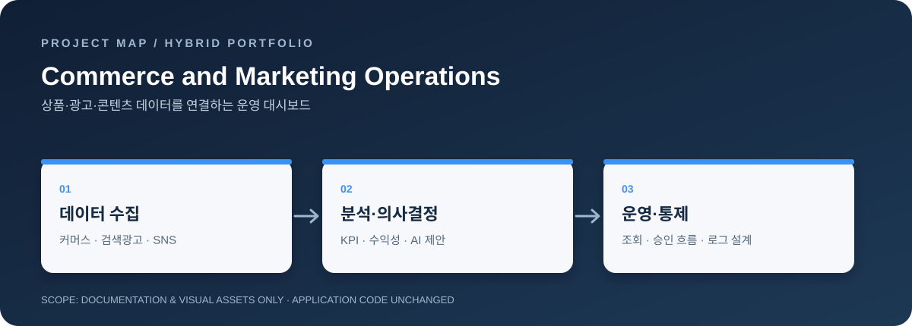
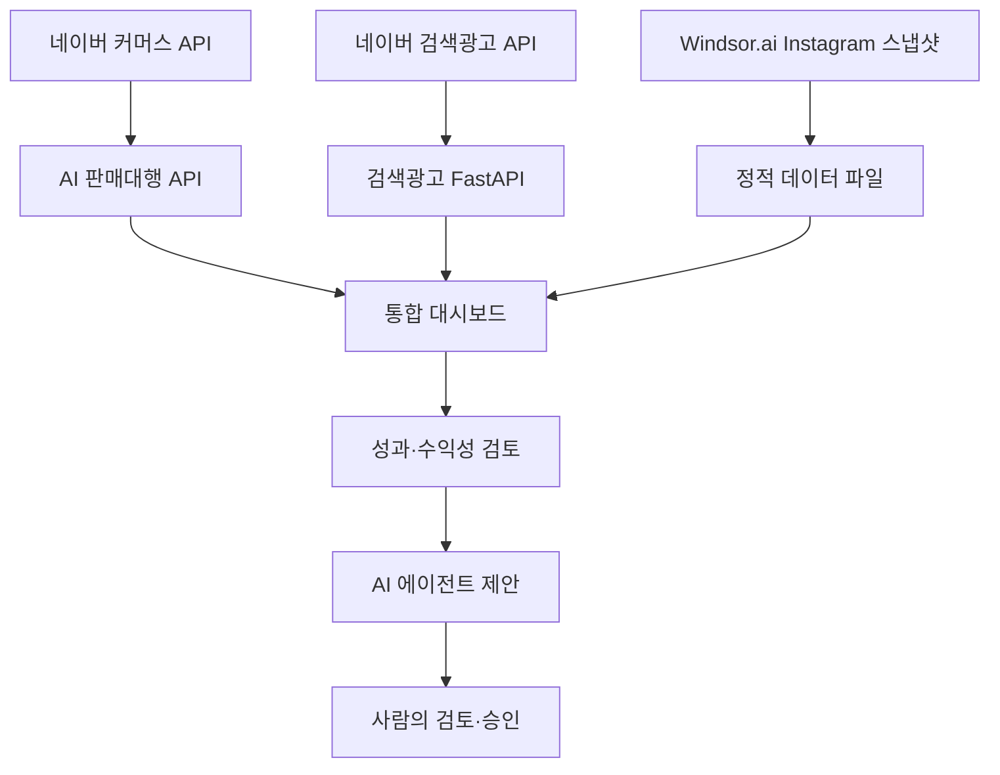

# Commerce & Marketing Operations Dashboard

**과메기 상품 운영을 중심으로 상품 데이터·검색광고·SNS 콘텐츠·AI 의사결정 흐름을 연결한 대시보드**

[실행 대시보드](https://ahky900-art.github.io/advertisement/) · [AI 에이전트 화면](https://ahky900-art.github.io/advertisement/agent.html) · [백엔드 API](./api_server.py) · [아키텍처 시각화](./docs/repo-architecture.svg)

## 1. 프로젝트 개요

스마트스토어 기반 상품 판매에서 상품 정보 확인, 광고 성과 점검, 수익성 검토, SNS 콘텐츠 기획을 한 흐름으로 관리하기 위한 운영 대시보드입니다.

핵심은 단순한 광고 지표 나열이 아니라 **상품 데이터 → 마케팅 성과 → 비용·수익성 판단 → AI 제안 → 사람의 검토·승인**으로 이어지는 운영 구조를 설계하는 것입니다.

## 2. 주요 기능

| 영역 | 저장소에서 확인되는 구현 |
|---|---|
| 통합 대시보드 | KPI, 상품·광고·콘텐츠 관련 화면 |
| 상품 분석 | 네이버 커머스 상품 검색 API를 호출하는 에이전트 백엔드 경로 |
| 검색광고 데이터 | 별도 FastAPI 서비스의 캠페인·광고그룹·기간별 통계 조회 경로 |
| Instagram | Windsor.ai에서 가져온 유기적 콘텐츠 성과 스냅샷 표시 |
| 콘텐츠 기획 | Instagram·YouTube 쇼츠 등 콘텐츠 기획 화면 |
| AI 에이전트 | 별도 화면 및 `POST /agent/chat` 채팅 API 경로 |
| 운영 통제 설계 | 광고 변경 승인·반려 UI 데모 및 서버 측 통제 필요사항 문서화 |

## 3. 데이터 및 서비스 흐름

## 4. 기술 구성

- Frontend: HTML, CSS, JavaScript
- API: Python, FastAPI, Uvicorn
- 네이버 커머스 인증: OAuth 토큰 발급 경로 및 서버 환경변수
- 검색광고: 별도 API 클라이언트와 조회 엔드포인트
- AI 에이전트: OpenAI SDK 기반 API 의존성 및 채팅 엔드포인트
- Deployment 구성: GitHub Pages 정적 프런트엔드, Render 백엔드 설정 파일

## 5. 실제 데이터와 데모의 구분

이 저장소는 실제 운영 데이터와 화면 데모가 함께 있으므로, 성과를 평가할 때 데이터 출처를 분리해야 합니다.

- **네이버 커머스:** `agent-api/main.py`에 상품 검색 API 호출과 상품 필드 정규화 로직이 있습니다. 실제 조회 성공 여부는 Render 환경변수와 네이버 계정 권한·API 응답 상태에 따라 달라집니다.
- **네이버 검색광고:** `api_server.py`에 캠페인·광고그룹·통계 조회 경로가 구현되어 있습니다. API 키·시크릿·고객 ID가 서버 환경변수로 설정되어야 합니다.
- **Instagram:** `instagram-data.js`를 사용하는 정적 스냅샷 방식입니다. 에이전트 API의 `/data/overview` 응답도 Instagram은 대시보드 스냅샷 파일이며 live API가 아니라고 명시합니다.
- **광고 성과·주문·매출:** 기존 README 기준으로 일부 화면 수치는 샘플이며 실제 광고 계정·주문 데이터와 연결되지 않은 영역이 있습니다.
- **AI 승인/반려:** 화면의 승인·반려는 데모입니다. 실제 광고 계정의 변경 실행 기능과 동일하지 않습니다.
- **YouTube:** 콘텐츠 기획 화면과 실제 YouTube 게시·성과 API 연동은 구분해야 합니다.

## 6. 실행 및 배포 구조

### Frontend
`index.html`을 브라우저에서 열거나 GitHub Pages로 배포합니다.

### 검색광고 API
저장소의 `render.yaml`은 `api_server.py`를 실행하는 Render 웹 서비스를 정의합니다. 다음 환경변수가 필요합니다.

- `NAVER_SA_API_KEY`
- `NAVER_SA_SECRET_KEY`
- `NAVER_SA_CUSTOMER_ID`

### AI 판매대행 API
`agent-api/` 아래 별도 FastAPI 서비스가 있으며, 커머스 상품 조회 및 에이전트 채팅 경로를 제공합니다. 실제 운영 시 네이버 커머스 인증정보와 LLM 키 등 비밀값은 서버 환경변수로 관리해야 합니다.

## 7. 운영 단계에서 보완할 사항

1. 광고·주문·매출 데이터의 실연동 범위를 화면에서 명확히 표시합니다.
2. 상품 원가, 손질비, 포장비, 배송비, 플랫폼 수수료, 광고비를 반영해 공헌이익과 ROI를 계산합니다. ROAS와 ROI를 혼용하지 않습니다.
3. AI 제안과 실제 계정 변경을 분리하고, 변경 전 재조회·승인·실행 로그·중복 실행 방지 절차를 서버 측에 둡니다.
4. API 키와 시크릿은 브라우저 코드나 README에 노출하지 않고 서버 비밀 환경변수로 관리합니다.
5. Instagram 스냅샷 갱신 주기와 데이터 기준일을 함께 기록합니다.

---

Portfolio note · 구현된 API 경로, 스냅샷 데이터, 샘플 지표, 화면 데모를 구분해 기술합니다.
